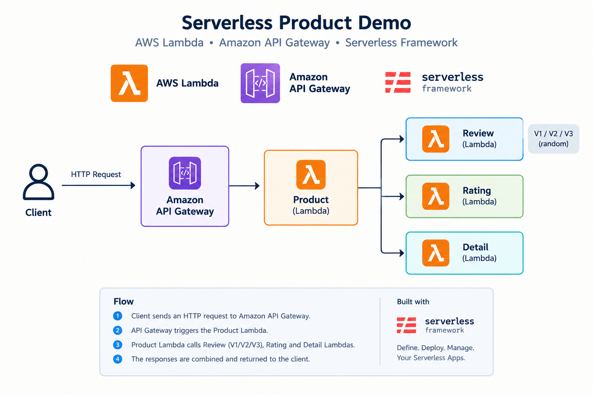
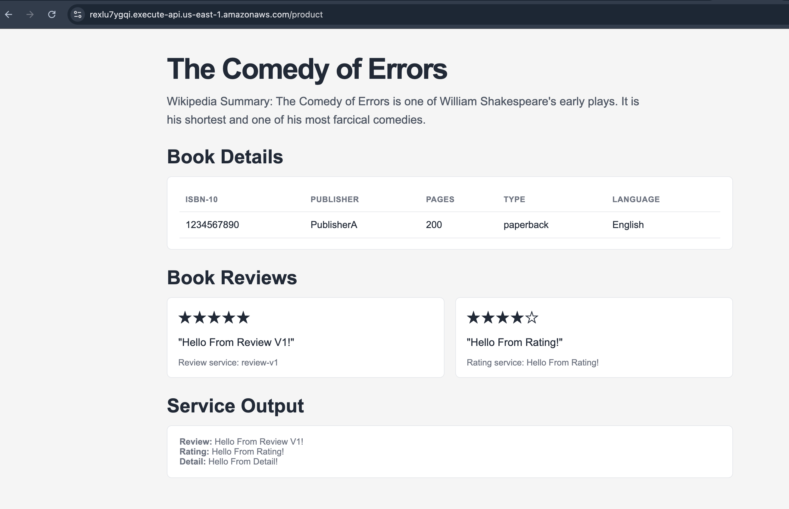

# Serverless Product Demo

A simple serverless microservice architecture built with **AWS Lambda, Amazon API Gateway, and the Serverless Framework**.




The Product service calls the Review, Rating, and Detail services and combines their responses into a single product page.

**Request flow:**

- Product → Review (V1, V2, or V3)
- Product → Rating
- Product → Detail

## Product Page Preview



## Project Structure

```
pov-serverless/
├── detail/
│   ├── handler.js
│   └── serverless.yml
├── ratings/
│   ├── handler.js
│   └── serverless.yml
├── review/
│   ├── handler.js
│   └── serverless.yml
├── product/
│   ├── handler.js
│   └── serverless.yml
├── architecture.png
├── result.png
├── deploy-serverless.sh
├── remove-serverless.sh
├── .env.example
├── README.md
└── .gitignore
```

## Prerequisites

- Node.js
- AWS CLI
- AWS credentials configured
- Serverless Framework

Install the Serverless Framework:

```
npm install -g serverless
```

Configure AWS credentials if needed:

```
aws configure
```

## Deploy

Copy the environment file, update the API Gateway URLs, and export them before deploying:

```bash
cp .env.example .env
# Update .env with your API Gateway URLs
set -a
source .env
set +a
./deploy-serverless.sh
```

Why this matters: `set -a` marks variables for export, `source .env` loads them into the current shell, and `set +a` stops exporting subsequent variables. This ensures Serverless receives the environment values at deploy time.

Alternatively, deploy each service manually from the project root:

```bash
cd detail && serverless deploy
cd ratings && serverless deploy
cd review && serverless deploy
cd product && serverless deploy
```

## Test the Product API

Replace `<product-api-id>` with your deployed API Gateway ID:

```
curl https://<product-api-id>.execute-api.us-east-1.amazonaws.com/product
```

Example response:

```
{
  "review": {
    "message": "Hello From Review V3!"
  },
  "rating": {
    "message": "Hello From Rating!"
  },
  "detail": {
    "message": "Hello From Detail!"
  }
}
```

## Useful Commands

```bash
serverless deploy --verbose
serverless logs -f <function-name>
serverless remove
```

Deploy all services with one script:
```bash
chmod +x deploy-serverless.sh
./deploy-serverless.sh
```

OR run services manually:
```bash
cd detail && serverless deploy
cd ratings && serverless deploy
cd review && serverless deploy
cd product && serverless deploy
```

Remove all deployed services with one script:
```bash
chmod +x remove-serverless.sh
./remove-serverless.sh
```

## Notes

- The Product service selects Review V1, V2, or V3 randomly.
- The Product service combines the responses from the Review, Rating, and Detail services.
- Each service is deployed independently.

## References

- [Serverless Framework Documentation](https://www.serverless.com/framework/docs/getting-started)
- [AWS Lambda Example Applications](https://docs.aws.amazon.com/lambda/latest/dg/example-apps.html)
